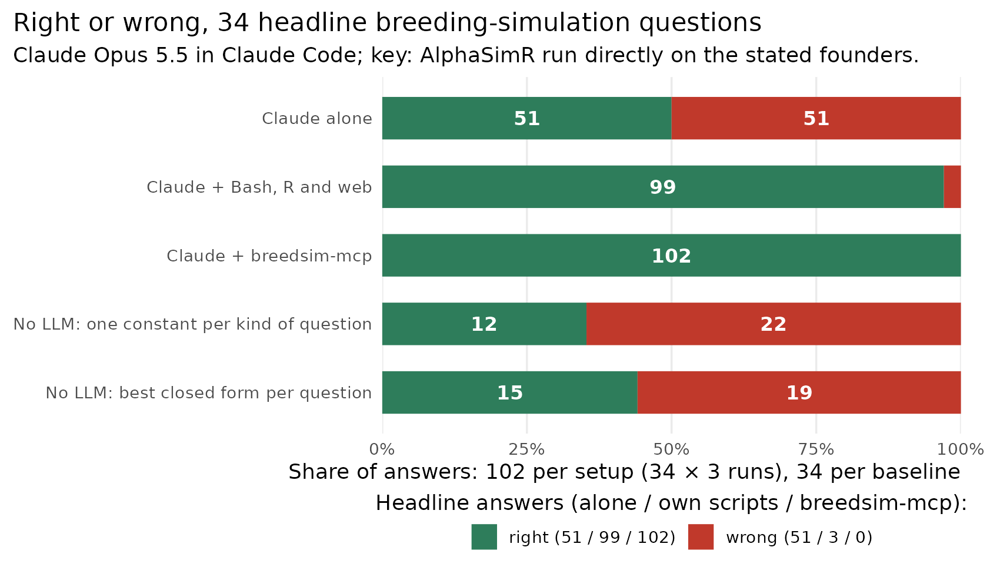
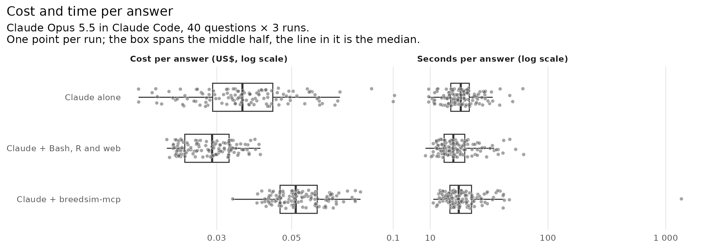

# Agent benchmark: breeding-simulation questions with and without the server

We asked Claude Opus 5.5 34 breeding-simulation questions, keyed by running
AlphaSimR directly, three times each: with no tools, with its own R and
AlphaSimR, and with breedsim-mcp. With the server it got 102 of 102 answers
right and with its own scripts 99 of 102, which is not separated on accuracy
(exact McNemar p = 1.0 over questions; difference 0.00 to 0.09, 95% bootstrap).
Both beat Claude alone, which got 51 of 102 (p < 1e-6). What separates the two
tool setups is cost: the server's median answer cost $0.051 [0.047, 0.054]
against $0.028 [0.026, 0.030] for Claude's own scripts, about 1.8 times as
much, while time is not separated. The main limitation is that each question
spells out the AlphaSimR calls, so this tests running a stated simulation, not
designing one.



## Results

34 headline questions × 3 runs, so 102 answers per setup; the 6 probability
questions are under Limitations. The no-LLM baselines answer each question
once. Intervals are 95% bootstrap over questions.

| Setup | Right | Wrong | Questions right in all 3 runs | Accuracy, 95% CI | Cost / answer, median [CI] | Seconds / answer, median [CI] | Tool calls, median |
|---|---|---|---|---|---|---|---|
| Claude alone | 51 | 51 | 12 of 34 | 0.50 [0.35, 0.65] | $0.036 [0.034, 0.040] | 18.0 [16.2, 19.7] | 0 |
| Claude + Bash, R and web | 99 | 3 | 33 of 34 | 0.97 [0.91, 1.00] | $0.028 [0.026, 0.030] | 15.2 [13.9, 16.9] | 2 |
| Claude + breedsim-mcp | 102 | 0 | 34 of 34 | 1.00 [1.00, 1.00] | $0.051 [0.047, 0.054] | 16.9 [15.5, 18.5] | 2 |
| No LLM: one constant per kind (the key's category median) | 12 | 22 | 12 of 34 (1 run) | 0.35 | - | - | - |
| No LLM: best named closed form per question | 15 | 19 | 15 of 34 (1 run) | 0.44 | - | - | - |

No setup declined a question and every run was valid. `summary.tsv` (from
`plot.R`) and `analysis.json` (from `analyse.py`) hold every number here.

Counting a question as right when all 3 runs were right, the server beats
Claude alone on 22 questions and loses on none (p = 5e-7), and Claude's own
scripts beat it on 21 and lose on none (p = 1e-6). Claude alone got the
one-cycle control right every time but only 0 of 15 genomic accuracy answers
and 9 of 24 gains after 5-10 cycles.

Claude's own scripts missed only q09, in all three runs. Each run used seeds
1-50 and answered 3.86, against a key of 3.65 ± 0.21: 3.05 standard errors
off, just past the band's 3. With the same seeds, the three runs are one Monte
Carlo draw repeated, not three independent misses.

One server run (q24, rep 3) took 1,360 s for the same two calls its sibling
runs made in about 15 s. We did not find the cause. It raises the server's mean
time to 31.8 s but not its median.



## Controls

All controls are in [`analyse.py`](analyse.py), which runs on the stored
results. `tests/test_agent_qa_controls.py` pairs each check with a case it
must reject, and each was seen to fail under a planted mutation.

- **Oracle.** The key's own values, written as replies, score 40 of 40 right
  through `score.py`; moved 1.5 band-widths, they score 0 of 40
  (`test_the_frozen_key_as_replies_scores_all_right_and_a_shifted_key_all_wrong`).
  `run.py` repeats this check before every sweep.
- **Baselines.** The category-median constant and every named closed form,
  scored through `score.py` on the questions each applies to. The textbook
  answer gets the control right (6 of 6, as designed) and the infinitesimal
  recursion lands in 9 of 23; every other closed form scored 0. Rows are in
  `baselines.tsv`, totals in `summary.tsv`.
- **Validity.** One rule for every setup: the run exited 0, its setup's tools
  were offered (read from the init event), and, outside the control, a tool
  setup made at least one tool call. An invalid run counts as not right. All
  360 runs were valid. The sweep was interrupted once; the one run in flight
  (Bash + R, q13, rep 2) was run again on resume, and no other run was
  retried.
- **Leak scan.** We searched the tool inputs and outputs of all 360
  transcripts for the key's file names, the benchmark directory (local or on
  GitHub), the key cache and the pilot directory (`LEAK_PATTERNS`). It found 0
  hits.

## Limitations

- **The questions spell out the R calls.** They test running a stated
  simulation, not designing one from a breeder's description. That favors the
  Bash setup, which can paste the calls.
- **A theory-literate answer can land in some bands.** The bands reject the
  named shortcuts, not every closed form. The infinitesimal recursion (Bulmer
  effect plus drift) lands inside 3 of 8 gain, 2 of 8 variance and 4 of 7
  scheme-difference bands.
- **Some bands admit a constant.** One number per kind of question (the key's
  median over that kind, which no setup can know) lands inside 12 of the 34
  headline bands: 2 of 6 controls, 0 of 8 gains, 3 of 8 variances, 4 of 7
  scheme differences and 3 of 5 genomic accuracies. A right answer on the last
  two kinds is weaker evidence than one on gains.
- **The 6 probability questions are out of the headline.** The same constant
  lands inside 5 of their 6 bands, because those bands are wide (a proportion
  from 100 replicates) and 5 of the 6 true probabilities lie between 0.70 and
  0.87. We decided to leave them out after the
  sweep, as a judgment on that result, not by a cutoff set in advance. It only
  lowers Claude alone's number: it got 15 of 18 right on them, and both tool
  setups 18 of 18. Over all 40 questions the setups got 66, 117 and 120 of 120,
  and the conclusions hold: server against own scripts p = 1.0, server against
  Claude alone p = 1.2e-7, own scripts against Claude alone p = 2.4e-7. The
  server does not return per-replicate values, so for these questions an agent
  using it must assume the paired difference is normal or make 100
  single-replicate calls; the Bash setup can count wins directly.
- **Runs could see shared files.** The Bash setup's scripts wrote to fixed
  paths such as `/tmp/sim/s.R` that later runs could also see; a per-run
  `TMPDIR` does not cover a literal path. In the raw transcripts (not in the
  repository), every Bash run that used such a path wrote it before reading
  it. This sweep also kept its results and transcripts inside the repository,
  where a Bash run could have listed them; the leak scan, which looks for
  `agent_qa` and `results.jsonl`, found no such access. New sweeps keep both
  outside (see Reproduce).
- **One model, one date.**

## Method

**Setups.** Claude Opus 5.5 in Claude Code, 3 runs per question per setup:

- **Claude alone**: no tools.
- **Claude + Bash, R and web**: Bash (R with AlphaSimR, and Python, on the
  PATH), Read, WebSearch and WebFetch. This is what a user has without the
  server: Claude can write and run its own AlphaSimR code.
- **Claude + breedsim-mcp**: this server only.

**Isolation.** Each run is a separate `claude -p` with `--setting-sources ""`,
an empty working directory and `--strict-mcp-config`, so no other MCP servers
load. Every setup gets the same short system prompt. Tool and Bash timeouts
are 15 minutes so a 50-replicate run is not cut off.

| What | Version | How fixed |
|---|---|---|
| Model / harness | claude-opus-5-5, Claude Code 2.1.302 | recorded per run (init event) |
| Server | breedsim-mcp 0.5.1 from PyPI via `uvx`; it resolved mcp 2.3.0, rpy2 3.5.17, numpy 2.5.4 on CPython 3.14.3 | server pinned in `run.py`; its dependencies were not |
| AlphaSimR (key, server and Bash setup) | 2.1.0 on R 4.3.3 | `run.py` refuses any other version; CI installs exactly 2.1.0, and a test checks key = pin = installed |

**The key.** The key is AlphaSimR driven directly by
[`simulate_key.R`](simulate_key.R), which shares no code with breedsim_mcp, on
the founders each question pins with a seed. So the benchmark measures whether
an agent sets up and runs the stated simulation correctly, not whether
AlphaSimR is right.
[`tests/test_agent_qa_key_matches_server.py`](../../tests/test_agent_qa_key_matches_server.py)
checks this on the real engine: on the same seeds the server's means equal the
key script's to the 4 significant figures the tools report (1e-9 before
2026-10-18) for phenotypic selection, genomic selection and a paired
comparison, a different selection intensity must not match, and two planted
mutations of the key script make it fail.

**Questions.** [`questions.json`](questions.json) holds the 40 questions and
their keys, built on AlphaSimR 2.1.0 with seed 20261016. `build_questions.py`
draws every design from fixed grids with a seeded RNG, so none is hand-picked.
All use quickHaplo founders (10 chromosomes × 100 segregating sites) and an
additive trait with 10 QTL per chromosome and founder genetic variance 1, which
is what `found_population` builds. Each question states the calls, the
statistic, the number of replicates to use and the band. `build_questions.py`,
`simulate_key.R` and `theory.py` never import `breedsim_mcp` (a test checks).

| Kind | Count | Design grid | Statistic | Key / answer replicates | Candidates rejected |
|---|---|---|---|---|---|
| Control: one-cycle response | 6 | N 500 or 1000, 5-30% selected | `meanG` after 1 generation | 400 / 50 | 3 of 18 |
| Gain after 5-10 cycles | 8 | N 20-100, 10-30% selected, h2 0.2-0.8 | `meanG` at the end | 400 / 50 | 0 of 16 |
| Genetic variance left after 5-10 cycles | 8 | as above | `varG` at the end | 400 / 50 | 1 of 16 |
| Difference between two schemes | 7 | N 30-100, 5-10% vs 30-50% selected, 5-15 cycles | paired `meanG(A) - meanG(B)` | 400 / 50 | 0 of 14 |
| Probability scheme A beats B | 6 | as above | share of paired replicates where A ends higher | 400 / 100 | 14 of 40 |
| Genomic prediction accuracy | 5 | N 100-300, 10-20% selected, 100-400 SNPs, 4-6 cycles | `cor(ebv, gv)` on the last progeny | 300 / 50 | 0 of 12 |

**The band** is `3 × sd × sqrt(1 / R_answer + 1 / R_key)`, rounded up to 2
significant figures, where `sd` is the per-replicate standard deviation in the
key's own replicates. There is no theory slack. The answer's own Monte Carlo
noise is 80-89% of the band's variance, so a careful answer from the stated
replicates lands inside about 99.7% of the time.

**Shortcuts.** A candidate design becomes a question only if every shortcut
named for its kind lands outside its band, and, in the control, the textbook
answer lands inside. The must-miss shortcuts (per-cycle R = h2 S, Bulmer
without drift, unchanged or drift-only variance, a certain or coin-flip
probability, and h, Daetwyler or zero for genomic accuracy) missed in every
question they apply to. `build_questions.py --discrimination` prints the
table, and
`test_every_named_shortcut_misses_its_band_and_the_control_answer_hits_it`
recomputes it from `theory.py` (promoting the infinitesimal recursion to
must-miss makes it fail).

**Scoring.** Each reply ends with `ANSWER: <number>` or `ANSWER: UNKNOWN`.
`score.py` reads only that line: right if the number is within the band,
wrong if it is outside or missing, declined for `UNKNOWN`, and no answer if
the line is absent. `79%`, a Unicode minus and thousands separators are read
as the number they spell. `agent_qa_error.png` plots each miss in units of its
band. The tests are in `tests/test_agent_qa_score.py`.

## History

1. **v1, theory key (commit 183f2c2).** Answers came from closed-form theory.
   In its pilot (2 questions × 3 setups) every answer was right with no tool
   call, and its bands could not reject common shortcuts (infinite-population
   intensity landed outside 0 of 12 bands). It measured textbook recall, so we
   replaced it before any sweep.
2. **v2, simulation key (this one).** Genomic accuracy moved from 1 cycle to
   4-6, because at 1 cycle the answer "zero" landed in 4 of 5 bands. The
   probability pool grew from 14 to 40 candidates, because only 4 of 14
   passed. In its pilot (2 questions), Claude alone was wrong on both and both
   tool setups were right.
3. **Controls added after the sweep:** validity, the leak scan, baselines, the
   oracle, paired statistics, and the probability questions out of the
   headline. Re-scoring the stored replies (`run.py --rescore`) changed no
   verdict.

The pilot rows, the v1 key and the v1 pilot transcripts are not in the
repository; the maintainer keeps them locally.

## Reproduce

Run from the repository root, with results and transcripts outside the
repository so a Bash-armed agent cannot find them:

```bash
OUT=~/breedsim-agent-qa   # any directory outside the repository
uv run python benchmarks/agent_qa/build_questions.py                  # re-derive the key (~20 min, 4 R processes)
uv run python benchmarks/agent_qa/build_questions.py --discrimination # shortcut table
uv run python benchmarks/agent_qa/run.py --reps 3 --workers 1 \
    --results "$OUT/results.jsonl" --runs "$OUT/runs"                 # 360 claude -p runs; resumable
uv run python benchmarks/agent_qa/run.py --rescore --results "$OUT/results.jsonl"  # after a key fix
uv run python benchmarks/agent_qa/analyse.py "$OUT/results.jsonl" "$OUT/runs"      # analysis.json + baselines.tsv beside the results
Rscript benchmarks/agent_qa/plot.R "$OUT/results.jsonl" "$OUT"                     # results path, output dir: summary.tsv + figures
```

With no arguments, `analyse.py` and `plot.R` redo the committed tables and
figures from the committed `results.jsonl`. `R_LIBS_USER` must point at a
library with AlphaSimR 2.1.0 (default `~/R/library`). The key build caches
each design's simulation (`AGENT_QA_KEY_CACHE`), and a rebuild from the cache
reproduced `questions.json` byte for byte. Raw transcripts are not committed.
